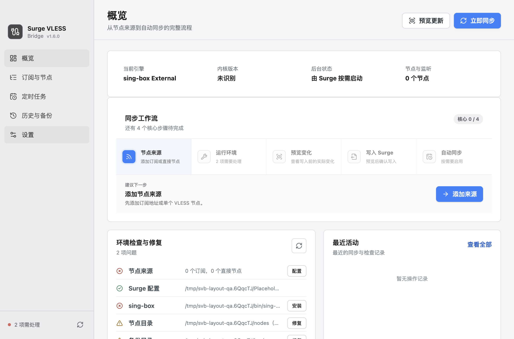

# surge-vless-bridge

[](https://www.npmjs.com/package/surge-vless-bridge)
[](https://www.npmjs.com/package/surge-vless-bridge)
[](https://github.com/kankankankankankan/surge-vless-bridge/actions/workflows/build-macos.yml)

[中文文档](./README.zh-CN.md) · [Changelog](./CHANGELOG.md)



**Surge Mac VLESS support with selectable sing-box External and Mihomo gateway runtimes.** External mode keeps the existing per-node process model. Mihomo mode uses one background process with loopback SOCKS5 listeners.

Surge Mac does not natively support the VLESS protocol. This tool bridges the gap: it fetches your subscription, generates a `sing-box` config per node, and keeps your Surge profile updated — so VLESS nodes work seamlessly through Surge's rules, policy groups, and dashboard.

## Prerequisites

- [sing-box](https://github.com/SagerNet/sing-box) installed (`brew install sing-box`)
- Surge Mac with a profile containing `[Proxy]` and `[Proxy Group]` sections

## macOS desktop app

The Electron desktop app manages subscriptions, selects the runtime, previews profile changes, runs syncs,
repairs the local environment, installs or updates either core, restores backups, and creates a background
macOS schedule. Existing configurations continue to use External mode.

```bash
npm install
npm run desktop
```

See the [desktop app guide](./docs/desktop-app.zh-CN.md) for packaging, scheduling, and recovery details.

GitHub Actions builds both macOS architectures on native runners. Download `x64` for Intel Macs and
`arm64` for Apple Silicon from the workflow run's Artifacts section.
Pushing a version tag such as `v1.6.0` automatically publishes both verified DMGs and their SHA-256 files to GitHub Releases.

## Setting this up with an AI agent

Nothing to install first. Paste this into Claude Code, Cursor, Codex or a similar agent and it handles
the whole setup — checking for and installing `sing-box` and the CLI, creating the config, syncing, and
verifying:

```text
Read https://github.com/kankankankankankan/surge-vless-bridge/blob/master/docs/agent-setup.md
and set up surge-vless-bridge for me.
```

[docs/agent-setup.md](./docs/agent-setup.md) tells the agent the command order, the config path rules,
how to read `doctor`, and which commands must not run without your confirmation. It will ask you for
your subscription URL and confirm your Surge profile path; everything else has a sensible default, and
it previews with `sync --dry-run` before writing anything.

Prefer to do it yourself? Follow the manual setup below.

## Manual setup

### Install

```bash
npm i -g surge-vless-bridge
```

### Quick Start

**1. Create a config file:**

```bash
surge-vless-bridge init
```

`init` asks for your subscription URL, then lets you pick a Surge profile with ↑/↓, and writes
`~/.config/surge-vless-bridge/config.json` — printing the exact path. Press Enter to skip the URL or
Esc to skip the profile and fill either in by hand later. Pass `--no-input` to skip both and just
write the template.

**2. Edit the config file** (only if you skipped a question):

```bash
# open the file printed by init, e.g.
open ~/.config/surge-vless-bridge/config.json
```

Fill in at minimum:

```json
{
  "subscriptionUrls": ["https://your-provider.com/subscription"],
  "surgeConfigPath": "/Users/you/Library/Application Support/Surge/Profiles/MyProfile.conf"
}
```

- **`subscriptionUrls`**: Your VLESS subscription URLs. Use one or more URLs; nodes from all subscriptions are merged into the same Surge policy group.

- **`surgeConfigPath`**: Absolute path to your Surge profile. To find it:
  1. Click the Surge icon in the **macOS menu bar**
  2. Go to **Switch Profile**, then click **Show in Finder** on your active profile
  3. Press `⌘ + i` on the file in Finder and copy the full path including the filename

  > Or list all profiles quickly in Terminal:
  >
  > ```bash
  > ls ~/Library/Application\ Support/Surge/Profiles/
  > ```

**3. Run a sync:**

```bash
surge-vless-bridge sync
```

`sync` fetches the subscription, generates sing-box configs, backs up your Surge profile, and updates it.

**4. Verify everything is correct:**

```bash
surge-vless-bridge doctor
```

## How sync protects your profile

- Nodes are generated and validated in a staging directory first; if anything fails, neither the Surge
  profile nor the previous node configs are touched.
- The Surge profile is backed up to `backupDir` before every write, and `restore` brings the latest
  backup back.
- Node configs produced by a sync are recorded in `manifest.json`, so `rebuild` never resurrects nodes
  that have been removed from the subscription.
- `sync` refuses to update the profile when no configured source yields a VLESS node, so one expired
  subscription cannot empty your policy group.
- Generated configs are checked with `sing-box check`, which validates the config against _your_
  installed sing-box: it catches unknown or unsupported options and invalid keys, but it does not test
  whether a node actually connects.

## Config File

Created by `init`. Default path: `~/.config/surge-vless-bridge/config.json`.

```json
{
  "subscriptionUrls": ["https://example.com/subscription-a", "https://example.com/subscription-b"],
  "vlessNodes": [
    "vless://uuid@example.com:443?type=tcp&security=reality&pbk=public-key&sid=short-id&fp=chrome&sni=example.com&flow=xtls-rprx-vision#Example"
  ],
  "surgeConfigPath": "/Users/you/Library/Application Support/Surge/Profiles/Config.conf",
  "policyGroupName": "VLESS",
  "policyGroupTargets": ["Proxy", "Auto"],
  "policyGroupExclusions": ["Hong Kong"],
  "policyGroupTargetModes": { "Proxy": "reference", "Auto": "auto" },
  "portStart": 2081,
  "udpRelay": false,
  "udpTestEnabled": false,
  "udpTestTarget": "apple.com@8.8.8.8",
  "tcpFastOpen": false,
  "connectTimeoutEnabled": false,
  "connectTimeoutSeconds": 10,
  "addressResolver": {
    "strategy": "doh",
    "filterSurgeFakeIp": true,
    "dohEndpoint": "https://1.1.1.1/dns-query",
    "dnsServers": ["1.1.1.1", "8.8.8.8"]
  }
}
```

**Required**

| Field              | Description                          |
| ------------------ | ------------------------------------ |
| `subscriptionUrls` | One or more VLESS subscription URLs  |
| `vlessNodes`       | One or more raw `vless://` node URLs |
| `surgeConfigPath`  | Absolute path to your Surge profile  |

`subscriptionUrl` is still supported for backward compatibility. When both `subscriptionUrl` and
`subscriptionUrls` are set, they are merged and deduplicated, with `subscriptionUrl` fetched first — so
adding a second provider never drops the original one. At least one of `subscriptionUrl`,
`subscriptionUrls`, or `vlessNodes` must be configured.

Nodes from every source share one policy group. Duplicate names get a numeric suffix (`HK 01 2`), and a
subscription that returns no VLESS nodes is reported as a warning rather than failing the sync.

**Optional**

| Field             | Default                                | Description                                            |
| ----------------- | -------------------------------------- | ------------------------------------------------------ |
| `policyGroupName`    | `"VLESS"`                              | Surge policy group name to populate                    |
| `policyGroupTargets` | `[]`                                   | Existing groups that should include the VLESS group    |
| `policyGroupExclusions` | `[]`                                | Existing groups that should remove the VLESS group     |
| `policyGroupTargetModes` | `{}`                                | Per-target `auto`, `merge`, or `reference` behavior    |
| `portStart`          | `2081`                                 | Starting local port; each node uses the next available |
| `singBoxBinary`      | auto-detected via `which sing-box`     | Path to the `sing-box` binary                          |
| `outputDir`          | `~/.config/surge-vless-bridge/nodes`   | Where per-node sing-box configs are written            |
| `backupDir`          | `~/.config/surge-vless-bridge/backups` | Where Surge profile backups are stored                 |
| `backupKeep`         | `20`                                   | How many backups to keep; older ones are pruned        |
| `autoReload`         | `true`                                 | Ask Surge to reload the profile after it changes       |
| `udpRelay`           | `false`                                | Add `udp-relay=true` to generated external proxies     |
| `udpTestEnabled`     | `false`                                | Add `test-udp` to UDP-enabled external proxies         |
| `udpTestTarget`      | `"apple.com@8.8.8.8"`                | Hostname and IPv4 address used by Surge UDP tests      |
| `tcpFastOpen`        | `false`                                | Enable TCP Fast Open for sing-box remote connections   |
| `connectTimeoutEnabled` | `false`                             | Use a custom remote connection timeout in External mode |
| `connectTimeoutSeconds` | `10`                               | External mode remote connection timeout in seconds     |
| `addressResolver`    | see below                              | How to resolve proxy server domains for `addresses=`   |

Enable `udpRelay` when VLESS should carry UDP traffic used by games, QUIC, voice calls, or UDP DNS.
The generated sing-box SOCKS inbound accepts UDP ASSOCIATE. Leave it disabled when the upstream node
does not support UDP or when only TCP traffic is needed.

When `udpTestEnabled` is enabled, external proxy entries include `test-udp=hostname@IPv4`. It requires `udpRelay`; the default target is `apple.com@8.8.8.8`.

`tcpFastOpen` is supported by both runtimes. The custom connection timeout is an External-only sing-box dial field and emits `connect_timeout=Ns` in each generated outbound. Mihomo uses its kernel default because its VLESS proxy schema has no per-proxy `connect-timeout` field.

`addressResolver.strategy` can be:

| Strategy | Description                                                                  |
| -------- | ---------------------------------------------------------------------------- |
| `doh`    | Resolve with `addressResolver.dohEndpoint`. This is the default.             |
| `dns`    | Resolve with `addressResolver.dnsServers`, such as `["1.1.1.1", "8.8.8.8"]`. |
| `system` | Use Node.js system DNS resolution.                                           |
| `off`    | Do not write `addresses=` in generated Surge external proxy entries.         |

Every strategy except `off` falls back to the other resolvers when it returns nothing usable, so a
failing DoH endpoint or a fake-ip system resolver still produces a real address.

Surge accepts a single value in `addresses=`. When a server resolves to several addresses, IPv4 is
preferred; IPv6 is written only when no A record exists.

`addressResolver.filterSurgeFakeIp` defaults to `true`. It filters `198.18.0.0/15` addresses before writing `addresses=`, avoiding Surge fake-ip results being pinned into external proxy entries.

### Why the default is `doh`

With Surge's enhanced mode enabled, system DNS answers with fake IPs in `198.18.0.0/15`. Resolving proxy
server domains through the system resolver would pin those fake IPs into `addresses=`, so nodes fail to
connect. `doh` bypasses the system resolver entirely, which means `sync` works without turning enhanced
mode off. Set `"strategy": "system"` only if your network blocks DoH endpoints.

You can also override fields at runtime:

```bash
surge-vless-bridge sync --subscription-url https://example.com/sub --group-name VLESS
```

## Commands

| Command                      | Description                                                   |
| ---------------------------- | ------------------------------------------------------------- |
| `surge-vless-bridge init`    | Create a config, asking for the subscription and Surge profile |
| `surge-vless-bridge sync`    | Fetch subscription → generate sing-box configs → update Surge |
| `surge-vless-bridge rebuild` | Rebuild Surge block from existing local configs (no network)  |
| `surge-vless-bridge restore` | Restore the latest Surge profile backup                       |
| `surge-vless-bridge clean`   | Remove generated configs and the managed Surge block          |
| `surge-vless-bridge doctor`  | Validate config, paths, ports and required Surge markers      |

### Previewing a sync

`sync --dry-run` reports the nodes, ports and profile changes a real sync would produce, and writes
nothing:

```bash
surge-vless-bridge sync --dry-run
```

### Automatic reload

Surge does not watch its profile, so a synced profile only takes effect after a reload. If the HTTP API
is enabled, the CLI triggers it automatically. Add this to `[General]` in your Surge profile:

```ini
http-api = your-key@127.0.0.1:6171
```

`surge-cli reload` is used as a fallback when it is available. Pass `--no-reload`, or set
`"autoReload": false`, to opt out. `doctor` reports which of these is in use.

Before an automatic reload, the bridge stops only sing-box processes whose command contains both the
configured binary path and a managed `outputDir/sing-box[PORT].json` path. This releases stale local
ports while leaving unrelated sing-box instances untouched.

### Removing everything

`policyGroupTargets` accepts existing Surge policy group names. `policyGroupTargetModes` controls how
each selected group receives VLESS. `auto` uses `merge` for `smart` groups and groups that already use
`include-other-group` or `policy-regex-filter`; other groups use `reference`. `merge` appends VLESS to
`include-other-group`, while `reference` adds VLESS as a direct group member. Surge does not allow a
`smart` group to reference another policy group directly, so `reference` is rejected for that case.

`policyGroupExclusions` removes VLESS from explicitly unchecked groups while preserving their other
members and parameters. The update preview shows the complete group line before and after each change.
Missing addition targets are rejected before the profile is written.

`clean` deletes the generated node configs, removes the managed block and policy group, and removes
the managed group from configured targets. The profile is backed up first.

```bash
surge-vless-bridge clean
```

---

## Development

For contributors working on the source code.

```bash
git clone https://github.com/kankankankankankan/surge-vless-bridge.git
cd surge-vless-bridge
npm install
```

Config file defaults to `.surge-vless-bridge.json` in the current directory, not the global path.

Run commands directly via `tsx` without building:

```bash
npm run sync         # tsx src/cli.ts sync
npm run doctor       # tsx src/cli.ts doctor
```

Build compiled output to `dist/`:

```bash
npm run build
```

## Acknowledgements

This project builds on the original [surge-vless-bridge](https://github.com/chen86860/surge-vless-bridge)
created by [chen86860](https://github.com/chen86860). The original author and copyright notice remain
in `package.json` and `LICENSE`.
