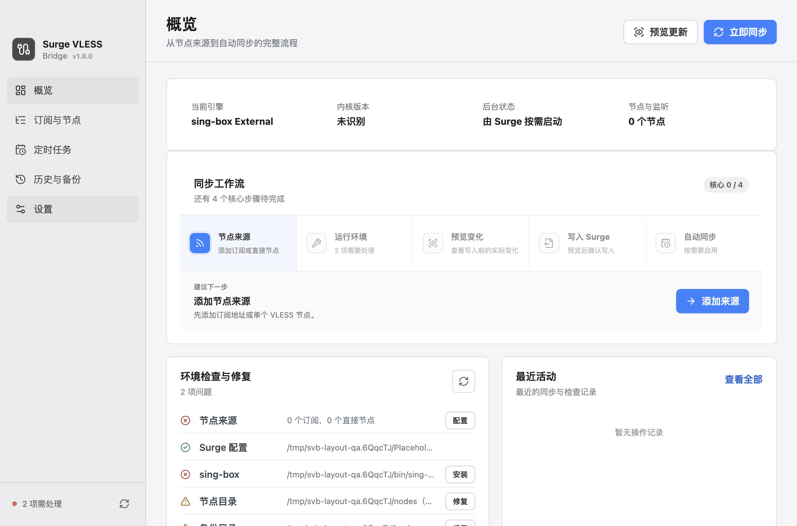

# surge-vless-bridge

[](https://www.npmjs.com/package/surge-vless-bridge)
[](https://www.npmjs.com/package/surge-vless-bridge)
[](https://github.com/kankankankankankan/surge-vless-bridge/actions/workflows/build-macos.yml)

[中文文档](./README.zh-CN.md) · [Changelog](./CHANGELOG.md)



**Surge Mac VLESS support with selectable sing-box External, Mihomo gateway, and Surge native VLESS runtimes.** External mode keeps the existing per-node process model. Mihomo mode uses one background process with loopback SOCKS5 listeners. Native mode writes Surge `vless` policies directly and requires Surge Mac 6.12.0 or newer.

Older Surge Mac versions do not natively support the VLESS protocol. This tool reads raw, Base64,
Clash YAML, or Clash JSON subscriptions, keeps the last valid result from each source, and updates your Surge
profile without discarding working nodes when one provider is temporarily unavailable.

## Prerequisites

- [sing-box](https://github.com/SagerNet/sing-box) installed (`brew install sing-box`) when using External mode
- Mihomo installed when using the gateway mode; the desktop app can install it
- Surge Mac 6.12.0 or newer for native VLESS; this mode needs no external core
- Surge Mac with a profile containing `[Proxy]` and `[Proxy Group]` sections

## macOS desktop app

The Electron desktop app manages named subscriptions, selects the runtime, previews profile changes, runs
syncs, repairs the local environment, installs or updates either core, restores backups, and creates a
background macOS schedule. It also shows the active traffic path, recent Mihomo logs, interrupted-update
recovery, and an optional HTTP/HTTPS proxy retry used only when a subscription cannot be downloaded directly.
Existing configurations continue to use External mode.

The schedule is installed as a per-user macOS LaunchAgent. After it is enabled, the desktop window does not
need to remain open for scheduled syncs to run.

```bash
npm install
npm run desktop
```

See the [desktop app guide](./docs/desktop-app.zh-CN.md) for packaging, scheduling, and recovery details.

GitHub Actions builds both macOS architectures on native runners. Download `x64` for Intel Macs and
`arm64` for Apple Silicon from the workflow run's Artifacts section.
Pushing a version tag such as `v1.6.0` automatically publishes both verified DMGs and their SHA-256 files to GitHub Releases.

## Surge native VLESS

Choose Surge Native VLESS in the desktop setup wizard or under Settings > Runtime Engine. CLI configurations
use `"runtimeMode": "surge-native"` and require runtime confirmation. Sync updates Surge policies and groups
directly, retaining previews, backups and scheduled updates without creating local listeners.

Example Reality + Vision output:

```ini
[Proxy]
Example = vless, node.example.com, 443, username=00000000-0000-4000-8000-000000000001, flow=xtls-rprx-vision, tls=true, reality-public-key=YOUR_PUBLIC_KEY, reality-short-id=01234567, sni=tls.example.com, ip-version=prefer-v4
```

This is a syntax example. Replace the domains, user ID, public key and short ID with your own node values.

- TLS and Reality policies explicitly emit `tls=true`; plaintext policies omit it. Reality also implies TLS.
- Surge Reality always uses Chrome's ClientHello. Share-link `fp` and Clash `client-fingerprint` values are not preserved.
- Reality verifies the server through its own handshake; `skip-cert-verify` does not apply to that verification.
- Native VLESS includes XUDP and needs no extra `udp-relay=true` parameter.
- Basic XHTTP conversion is supported. Unmapped XHTTP `extra` options produce an explicit conversion error.

Surge Mac 6.12.0+ can import `vless://` links in its proxy editor: click Import… next to Share Link and paste
the link. The same entry accepts `Name = vless, ...` policy lines. This import feature belongs to Surge itself.

Native mode resolves node domains using Surge's DNS configuration. The Bridge's External address resolver
does not change that configuration. External `addresses=` excludes endpoints from VIF routes; it does not
select the IP dialed by sing-box and does not apply to native policies. Compare the same node, test URL and
resolved addresses when investigating client differences. Passing syntax validation does not prove connectivity.

References: [Surge VLESS parameters](https://manual.nssurge.com/policies/vless.html),
[share-link import](https://manual.nssurge.com/policies/overview.html#importing-from-share-links-ios-600-mac-6120),
and [per-domain DNS](https://manual.nssurge.com/dns/local-dns-mapping.html#assigning-dns-servers).

## Manual setup

### Install

```bash
npm i -g surge-vless-bridge
```

### Quick Start

**1. Create a config file:**

```bash
surge-vless-bridge init
```

`init` asks for your subscription URL, then lets you pick a Surge profile with ↑/↓, and writes
`~/.config/surge-vless-bridge/config.json` — printing the exact path. Press Enter to skip the URL or
Esc to skip the profile and fill either in by hand later. Pass `--no-input` to skip both and just
write the template.

**2. Edit the config file** (only if you skipped a question):

```bash
# open the file printed by init, e.g.
open ~/.config/surge-vless-bridge/config.json
```

Fill in at minimum:

```json
{
  "subscriptionUrls": ["https://your-provider.com/subscription"],
  "surgeConfigPath": "/Users/you/Library/Application Support/Surge/Profiles/MyProfile.conf"
}
```

- **`subscriptionUrls`**: Your VLESS subscription URLs. Use one or more URLs; nodes from all subscriptions are merged into the same Surge policy group.

- **`surgeConfigPath`**: Absolute path to your Surge profile. To find it:
  1. Click the Surge icon in the **macOS menu bar**
  2. Go to **Switch Profile**, then click **Show in Finder** on your active profile
  3. Press `⌘ + i` on the file in Finder and copy the full path including the filename

  > Or list all profiles quickly in Terminal:
  >
  > ```bash
  > ls ~/Library/Application\ Support/Surge/Profiles/
  > ```

**3. Run a sync:**

```bash
surge-vless-bridge sync
```

`sync` fetches the subscription, generates sing-box configs, backs up your Surge profile, and updates it.

**4. Verify everything is correct:**

```bash
surge-vless-bridge doctor
```

## How sync protects your profile

- Nodes are generated and validated in a staging directory first; if anything fails, neither the Surge
  profile nor the previous node configs are touched.
- The Surge profile is backed up to `backupDir` before every write, and `restore` brings the latest
  backup back.
- Node configs produced by a sync are recorded in `manifest.json`, so `rebuild` never resurrects nodes
  that have been removed from the subscription.
- `sync` refuses to update the profile when no configured source yields a VLESS node, so one expired
  subscription cannot empty your policy group.
- Generated configs are checked with `sing-box check`, which validates the config against _your_
  installed sing-box: it catches unknown or unsupported options and invalid keys, but it does not test
  whether a node actually connects.

## Config File

Created by `init`. Default path: `~/.config/surge-vless-bridge/config.json`.

```json
{
  "subscriptionUrls": ["https://example.com/subscription-a", "https://example.com/subscription-b"],
  "vlessNodes": [
    "vless://uuid@example.com:443?type=tcp&security=reality&pbk=public-key&sid=short-id&fp=chrome&sni=example.com&flow=xtls-rprx-vision#Example"
  ],
  "surgeConfigPath": "/Users/you/Library/Application Support/Surge/Profiles/Config.conf",
  "policyGroupName": "VLESS",
  "policyGroupTargets": ["Proxy", "Auto"],
  "policyGroupExclusions": ["Hong Kong"],
  "policyGroupTargetModes": { "Proxy": "reference", "Auto": "auto" },
  "portStart": 2081,
  "udpRelay": false,
  "udpTestEnabled": false,
  "udpTestTarget": "apple.com@8.8.8.8",
  "tcpFastOpen": false,
  "connectTimeoutEnabled": false,
  "connectTimeoutSeconds": 10,
  "subscriptionProxyUrl": "",
  "addressResolver": {
    "strategy": "doh",
    "filterSurgeFakeIp": true,
    "dohEndpoint": "https://1.1.1.1/dns-query",
    "dnsServers": ["1.1.1.1", "8.8.8.8"]
  }
}
```

**Required**

| Field              | Description                          |
| ------------------ | ------------------------------------ |
| `subscriptionUrls` | One or more VLESS subscription URLs  |
| `vlessNodes`       | One or more raw `vless://` node URLs |
| `surgeConfigPath`  | Absolute path to your Surge profile  |

`subscriptionUrl` is still supported for backward compatibility. When both `subscriptionUrl` and
`subscriptionUrls` are set, they are merged and deduplicated, with `subscriptionUrl` fetched first — so
adding a second provider never drops the original one. At least one of `subscriptionUrl`,
`subscriptionUrls`, or `vlessNodes` must be configured.

Nodes from every source share one policy group. Duplicate names get a numeric suffix (`HK 01 2`), and a
subscription that returns no VLESS nodes is reported as a warning rather than failing the sync.

**Optional**

| Field             | Default                                | Description                                            |
| ----------------- | -------------------------------------- | ------------------------------------------------------ |
| `policyGroupName`    | `"VLESS"`                              | Surge policy group name to populate                    |
| `policyGroupTargets` | `[]`                                   | Existing groups that should include the VLESS group    |
| `policyGroupExclusions` | `[]`                                | Existing groups that should remove the VLESS group     |
| `policyGroupTargetModes` | `{}`                                | Per-target `auto`, `merge`, or `reference` behavior    |
| `portStart`          | `2081`                                 | Starting local port; each node uses the next available |
| `singBoxBinary`      | auto-detected via `which sing-box`     | Path to the `sing-box` binary                          |
| `outputDir`          | `~/.config/surge-vless-bridge/nodes`   | Where per-node sing-box configs are written            |
| `backupDir`          | `~/.config/surge-vless-bridge/backups` | Where Surge profile backups are stored                 |
| `backupKeep`         | `20`                                   | How many backups to keep; older ones are pruned        |
| `autoReload`         | `true`                                 | Ask Surge to reload the profile after it changes       |
| `udpRelay`           | `false`                                | Add `udp-relay=true` to generated external proxies     |
| `udpTestEnabled`     | `false`                                | Add `test-udp` to UDP-enabled external proxies         |
| `udpTestTarget`      | `"apple.com@8.8.8.8"`                | Hostname and IPv4 address used by Surge UDP tests      |
| `tcpFastOpen`        | `false`                                | Enable TCP Fast Open for sing-box remote connections   |
| `connectTimeoutEnabled` | `false`                             | Use a custom remote connection timeout in External mode |
| `connectTimeoutSeconds` | `10`                               | External mode remote connection timeout in seconds     |
| `subscriptionProxyUrl` | `""`                                | HTTP/HTTPS proxy used only to retry failed subscription downloads |
| `addressResolver`    | see below                              | How to resolve proxy server domains for `addresses=`   |
| `mihomo.dnsMode`     | `"inherit"`                          | Resolve Mihomo node domains by inheritance, dedicated DNS, DoH, DoT, or system DNS |
| `mihomo.dnsIpv6`     | `true`                                 | Query AAAA records for Mihomo node servers             |
| `mihomo.tcpConcurrent` | `true`                               | Race multiple resolved node IPs and use the first successful connection |

Enable `udpRelay` when VLESS should carry UDP traffic used by games, QUIC, voice calls, or UDP DNS.
The generated sing-box SOCKS inbound accepts UDP ASSOCIATE. Leave it disabled when the upstream node
does not support UDP or when only TCP traffic is needed.

When `udpTestEnabled` is enabled, external proxy entries include `test-udp=hostname@IPv4`. It requires `udpRelay`; the default target is `apple.com@8.8.8.8`.

`tcpFastOpen` is supported by all three runtimes. The custom connection timeout is an External-only sing-box dial field and emits `connect_timeout=Ns` in each generated outbound. Mihomo uses its kernel default because its VLESS proxy schema has no per-proxy `connect-timeout` field. Native mode does not create local listeners or `addresses=` entries.

`subscriptionProxyUrl` is tried only after the direct subscription request fails. It accepts an unauthenticated
`http://` or `https://` proxy URL and does not change Surge traffic or VLESS node routing.

`addressResolver.strategy` can be:

| Strategy | Description                                                                  |
| -------- | ---------------------------------------------------------------------------- |
| `doh`    | Resolve with `addressResolver.dohEndpoint`. This is the default.             |
| `dot`    | Resolve through certificate-verified DoT using a `tls://` endpoint.           |
| `dns`    | Resolve with `addressResolver.dnsServers`, such as `["1.1.1.1", "8.8.8.8"]`. |
| `system` | Use Node.js system DNS resolution.                                           |
| `off`    | Do not write `addresses=` in generated Surge external proxy entries.         |

Every strategy except `off` falls back to the other configured resolver types when it returns nothing
usable, so a failing encrypted endpoint or a fake-ip system resolver can still produce a real address.

Surge accepts repeated `addresses=` parameters. Every resolved IPv4 and IPv6 address is written,
with IPv4 addresses first; Surge fake IPs are removed first.

`addressResolver.filterSurgeFakeIp` defaults to `true`. It filters `198.18.0.0/15` addresses before writing `addresses=`, avoiding Surge fake-ip results being pinned into external proxy entries.

Mihomo resolves node server domains at runtime through its own DNS module. `mihomo.dnsMode` accepts `inherit`, `dns`, `doh`, `dot`, or `system`; dedicated values come from `mihomo.dnsServers` and `mihomo.dohEndpoint`. The desktop app shares one editable preset catalog between Mihomo and External, displays endpoint values in every choice, and includes AliDNS and DNSPod DoH/DoT alongside Cloudflare, Google, and Quad9. Generated configs set `proxy-server-nameserver` explicitly and do not expose a DNS listener. With Surge Enhanced Mode enabled, prefer dedicated DNS, DoH, DoT, or an inherited non-system resolver so the macOS system resolver cannot return fake IPs for node domains.

### Why the default is `doh`

With Surge's enhanced mode enabled, system DNS answers with fake IPs in `198.18.0.0/15`. Resolving proxy
server domains through the system resolver would pin those fake IPs into `addresses=`, so nodes fail to
connect. `doh` bypasses the system resolver entirely, which means `sync` works without turning enhanced
mode off. Set `"strategy": "system"` only if your network blocks DoH endpoints.

You can also override fields at runtime:

```bash
surge-vless-bridge sync --subscription-url https://example.com/sub --group-name VLESS
```

## Commands

| Command                      | Description                                                   |
| ---------------------------- | ------------------------------------------------------------- |
| `surge-vless-bridge init`    | Create a config, asking for the subscription and Surge profile |
| `surge-vless-bridge sync`    | Fetch subscription → generate sing-box configs → update Surge |
| `surge-vless-bridge rebuild` | Rebuild Surge block from existing local configs (no network)  |
| `surge-vless-bridge restore` | Restore the latest Surge profile backup                       |
| `surge-vless-bridge clean`   | Remove generated configs and the managed Surge block          |
| `surge-vless-bridge doctor`  | Validate config, paths, ports and required Surge markers      |

### Previewing a sync

`sync --dry-run` reports the nodes, ports and profile changes a real sync would produce, and writes
nothing:

```bash
surge-vless-bridge sync --dry-run
```

### Automatic reload

Surge does not watch its profile, so a synced profile only takes effect after a reload. If the HTTP API
is enabled, the CLI triggers it automatically. Add this to `[General]` in your Surge profile:

```ini
http-api = your-key@127.0.0.1:6171
```

`surge-cli reload` is used as a fallback when it is available. Pass `--no-reload`, or set
`"autoReload": false`, to opt out. `doctor` reports which of these is in use.

Before an automatic reload, the bridge stops only sing-box processes whose command contains both the
configured binary path and a managed `outputDir/sing-box[PORT].json` path. This releases stale local
ports while leaving unrelated sing-box instances untouched.

### Removing everything

`policyGroupTargets` accepts existing Surge policy group names. `policyGroupTargetModes` controls how
each selected group receives VLESS. `auto` uses `merge` for `smart` groups and groups that already use
`include-other-group` or `policy-regex-filter`; other groups use `reference`. `merge` appends VLESS to
`include-other-group`, while `reference` adds VLESS as a direct group member. Surge does not allow a
`smart` group to reference another policy group directly, so `reference` is rejected for that case.

`policyGroupExclusions` removes VLESS from explicitly unchecked groups while preserving their other
members and parameters. The update preview shows the complete group line before and after each change.
Missing addition targets are rejected before the profile is written.

`clean` deletes the generated node configs, removes the managed block and policy group, and removes
the managed group from configured targets. The profile is backed up first.

```bash
surge-vless-bridge clean
```

---

## Development

For contributors working on the source code.

```bash
git clone https://github.com/kankankankankankan/surge-vless-bridge.git
cd surge-vless-bridge
npm install
```

Config file defaults to `.surge-vless-bridge.json` in the current directory, not the global path.

Run commands directly via `tsx` without building:

```bash
npm run sync         # tsx src/cli.ts sync
npm run doctor       # tsx src/cli.ts doctor
```

Build compiled output to `dist/`:

```bash
npm run build
```

## Acknowledgements

This project builds on the original [surge-vless-bridge](https://github.com/chen86860/surge-vless-bridge)
created by [chen86860](https://github.com/chen86860). The original author and copyright notice remain
in `package.json` and `LICENSE`.

Thanks also to [ssfun](https://github.com/ssfun) and the contributors to
[Surge External Bridge](https://github.com/ssfun/surge-external-bridge).
Its [architecture and usage documentation](https://github.com/ssfun/surge-external-bridge/blob/main/README.md)
informed our Mihomo gateway design. Its [automatic update documentation](https://github.com/ssfun/surge-external-bridge/blob/main/docs/auto-update.md)
is also a reference for future update verification and recovery work.
Our implementation runs a separate Mihomo executable with per-node loopback listeners;
Surge External Bridge embeds Mihomo and routes nodes through an authenticated shared SOCKS5 endpoint.
This project retains its MIT license. Citations and acknowledgements do not imply incorporation of GPL source from the reference project.
