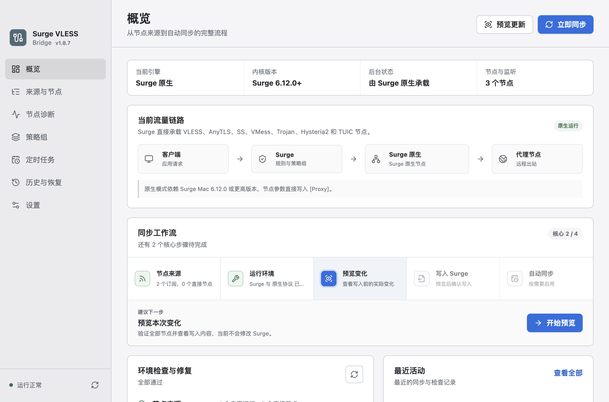

# surge-vless-bridge

[](https://www.npmjs.com/package/surge-vless-bridge)
[](https://www.npmjs.com/package/surge-vless-bridge)
[](https://github.com/kankankankankan/surge-vless-bridge/actions/workflows/build-macos.yml)

[English README](./README.md) · [更新日志](./CHANGELOG.zh-CN.md)



截图使用隔离的示例数据。

**将订阅转换为 Surge 策略，并可选择 sing-box External、Mihomo 网关或 Surge 原生。** External 模式保持每节点 VLESS 进程，Mihomo 模式使用单个后台进程和回环 SOCKS5 listeners 承载 VLESS，原生模式按各节点协议写入 Surge 对应策略。

Surge Mac 6.12.0 起原生支持 VLESS。该工具可读取明文 VLESS 或混合 V2Ray/Xray 链接、Base64、Clash YAML 和 Clash JSON 订阅，
原生模式导入已映射的协议，外部内核模式提取 VLESS，
按来源保留最近一次有效结果，并在某个订阅临时不可用时避免清空仍可工作的节点。

## 前置条件

- External 模式需要 [sing-box](https://github.com/SagerNet/sing-box)（`brew install sing-box`）；Mihomo 模式需要 Mihomo，可在桌面应用中安装
- 原生 VLESS 需要 Surge Mac 6.12.0 或更高版本；SS、VMess、Trojan、AnyTLS、Hysteria2 和 TUIC 使用各自原生策略，无需外部内核
- Surge Mac 配置文件中包含 `[Proxy]` 和 `[Proxy Group]` 区块

## macOS 桌面应用

仓库包含 Electron 桌面界面，可以管理带名称的订阅、切换运行引擎、预览更新、执行同步、检查并修复环境、
安装内核、配置 DNS、恢复备份和管理 macOS 定时任务。界面还会显示当前流量链路、Mihomo 最近日志、
中断更新恢复，以及仅在订阅直连失败后使用的可选 HTTP/HTTPS 代理重试。旧配置继续使用 External 模式；原生模式可直接转换已映射的多协议节点。

定时任务由当前用户的 macOS LaunchAgent 执行。启用并保存后，即使关闭桌面窗口也会继续按计划同步。

「节点诊断」支持三种运行方式的 TCP/HTTP 与 UDP 检测，延迟显示整数毫秒。Surge 原生使用自身 CLI，旧版缺少 UDP 命令时提示未测试。External/Mihomo 使用本机 SOCKS5 链路，需开启 UDP 转发。

「策略组」集中选择成员关系，预览后同步生效。「历史与恢复」集中显示日志、备份和维护操作，并可导出不含订阅地址、节点凭据、完整路径和日志正文的诊断摘要。设置页支持快速选择最近的 Surge 配置文件，只改变 Bridge 写入目标，不切换 Surge 活动档案。

「设置 > 外观」支持跟随系统、浅色和深色，点击即时生效并记住选择。运行引擎选择和配置向导使用各引擎官方来源的图标，离线显示。外观偏好不会修改 Surge 配置或订阅。

```bash
npm install
npm run desktop
```

生成本地 `.app`：

```bash
npm run desktop:icon
npm run desktop:package
```

详细操作和恢复方法见 [macOS 桌面应用指南](./docs/desktop-app.zh-CN.md)。

GitHub Actions 会在原生 Intel 和 Apple 芯片 runner 上分别构建。Intel Mac 下载 `x64`，M 系列 Mac 下载
`arm64`，成品位于对应工作流运行记录的 Artifacts 区域。
推送 `v1.6.0` 这类版本标签后，验证通过的两个 DMG 和 SHA-256 文件会自动发布到 GitHub Releases。

## Surge 原生多协议

「设置 > AnyTLS TLS 与连接」支持为指定服务器与端口分别覆盖 SNI、证书校验名称和连接复用。定时任务使用同一 `anytlsSniOverrides` 设置，例如 `{ "server": "node.example.com", "port": 443, "sni": "sni.example.com", "certificateVerifyName": "cert.example.com", "reuse": true }`。各项可独立恢复跟随订阅，旧版 SNI 设置继续兼容。不修改密码、ALPN 或跳过校验选择，不自动猜测服务器身份。完整映射和版本要求见[原生参数说明](docs/native-parameters.zh-CN.md)。

桌面应用的配置向导和「设置 > 运行引擎」均可选择「Surge 原生」。CLI 配置使用
`"runtimeMode": "surge-native"`，并完成运行方式确认。同步直接更新 Surge `[Proxy]` 与策略组，
保留预览、备份和定时同步，不创建本地监听端口。

原生模式支持 VLESS、SS、VMess、Trojan、AnyTLS、Hysteria2（含 `hy2://`）、TUIC v4 和 TUIC v5 的链接、Base64 及 Clash YAML/JSON。AnyTLS 转为独立的 `anytls` 策略，保留密码与 TLS 设置。Hysteria 1、SSR 和未知协议显示兼容提示；未映射的传输或重要参数明确报错，并保留该来源上次成功缓存。可在「筛选与兼容」中选择跳过已识别的不兼容节点。

External 与 Mihomo 仍只转换 VLESS，其他协议会提示未导入。本版不支持 V2Ray/Xray `outbounds` 完整 JSON 配置。QUIC 属于传输层；Hysteria2 和 TUIC 各自使用对应协议类型。

参数依据：[AnyTLS](https://manual.nssurge.com/policies/anytls.html)、[Shadowsocks](https://manual.nssurge.com/policies/shadowsocks.html)、[VMess](https://manual.nssurge.com/policies/vmess.html)、[Hysteria2](https://manual.nssurge.com/policies/hysteria2.html)、[TUIC](https://manual.nssurge.com/policies/tuic.html)。

Reality + Vision 节点生成示例：

```ini
[Proxy]
Example = vless, node.example.com, 443, username=00000000-0000-4000-8000-000000000001, flow=xtls-rprx-vision, tls=true, reality-public-key=YOUR_PUBLIC_KEY, reality-short-id=01234567, sni=tls.example.com, ip-version=prefer-v4
```

上例为格式示例，域名、用户 ID、公钥和 short-id 均需替换为自己的节点参数。

- TLS 和 Reality 节点均显式写出 `tls=true`；明文节点不添加此项。Reality 本身也隐含 TLS。
- Surge 的 Reality 固定使用 Chrome ClientHello，分享链接的 `fp` 和 Clash 的 `client-fingerprint` 不会原样保留。
- Reality 使用自身握手验证，`skip-cert-verify` 不参与其证书验证。
- Surge 原生 VLESS 内置 XUDP，无需额外写 `udp-relay=true`。
- XHTTP `extra` 支持官方客户端填充、上传、请求头与 XMUX 参数。独立下载、未知字段和未映射字段明确报错。

Surge Mac 6.12.0+ 的代理编辑器支持 `vless://` 分享链接：点击「Share Link」旁的「Import…」，
粘贴链接导入。该入口也支持 `Name = vless, ...` 策略行。分享链接导入属于 Surge 自身功能。

原生模式使用 Surge 自己的 DNS 配置解析节点域名，Bridge 的 External 地址解析设置不会改写该 DNS。
External 的 `addresses=` 只排除 VIF 路由，不指定 sing-box 实际连接的 IP，也不适用于原生模式。
比较客户端连通性时，应核对相同节点、测试目标及解析地址；原生策略通过语法检查不代表实际连接成功。

参考：[Surge VLESS 参数](https://manual.nssurge.com/policies/vless.html)、
[分享链接导入](https://manual.nssurge.com/policies/overview.html#importing-from-share-links-ios-600-mac-6120)、
[按域名指定 DNS](https://manual.nssurge.com/dns/local-dns-mapping.html#assigning-dns-servers)。

## 手动配置

### 安装

```bash
npm i -g surge-vless-bridge
```

### 快速开始

**1. 生成配置文件：**

```bash
surge-vless-bridge init
```

`init` 会先询问订阅地址，再用 ↑/↓ 选择 Surge 配置文件，然后写入
`~/.config/surge-vless-bridge/config.json` 并打印具体路径。订阅地址直接回车、配置文件按 Esc 即可跳过，
之后手动填写；加 `--no-input` 则跳过全部提问，只写模板。

**2. 编辑配置文件**（仅在跳过了提问时需要）：

```bash
# 用 init 打印的路径打开文件，例如：
open ~/.config/surge-vless-bridge/config.json
```

至少填写以下两个字段：

```json
{
  "subscriptionUrls": ["https://your-provider.com/subscription"],
  "surgeConfigPath": "/Users/you/Library/Application Support/Surge/Profiles/MyProfile.conf"
}
```

- **`subscriptionUrls`**：填入一个或多个 VLESS 订阅地址，所有订阅里的节点会合并到同一个 Surge 策略组。

- **`surgeConfigPath`**：Surge 配置文件的绝对路径。获取方式：
  1. 点击 macOS **菜单栏**中的 Surge 图标
  2. 选择 **切换配置**，在当前使用的配置文件上点击 **在访达中显示**
  3. 在 Finder 中对该文件按 `⌘ + i`，复制"位置"下的完整路径，拼上文件名填入

  > 也可以通过终端快速查看所有配置文件：
  >
  > ```bash
  > ls ~/Library/Application\ Support/Surge/Profiles/
  > ```

**3. 执行同步：**

```bash
surge-vless-bridge sync
```

`sync` 会依次完成：拉取订阅 → 生成 sing-box 配置 → 备份 Surge 配置 → 更新 Surge 配置。

**4. 验证配置是否正常：**

```bash
surge-vless-bridge doctor
```

## 同步过程如何保护你的配置

- 节点先在临时目录里生成并校验，任一环节失败都不会动到 Surge 配置，也不会破坏上一次同步的节点配置。
- 每次写入 Surge 配置前都会备份到 `backupDir`，`restore` 可以恢复最近一次备份。
- 每次同步产生的节点配置会记录在 `manifest.json` 中，因此 `rebuild` 不会复活已从订阅里删除的节点。
- 所有来源都没有解析出 VLESS 节点时，`sync` 拒绝改写配置，避免某个机场过期导致策略组被清空。
- 生成的配置会经过 `sing-box check`，用的是**你本机安装的** sing-box：能查出不支持的选项和非法密钥，但
  **不能验证节点是否真的连得通**。

## 配置文件

由 `init` 创建，默认路径：`~/.config/surge-vless-bridge/config.json`。

```json
{
  "subscriptionUrls": ["https://example.com/subscription-a", "https://example.com/subscription-b"],
  "vlessNodes": [
    "vless://uuid@example.com:443?type=tcp&security=reality&pbk=public-key&sid=short-id&fp=chrome&sni=example.com&flow=xtls-rprx-vision#Example"
  ],
  "surgeConfigPath": "/Users/you/Library/Application Support/Surge/Profiles/Config.conf",
  "policyGroupName": "VLESS",
  "policyGroupTargets": ["代理", "自动选择"],
  "policyGroupExclusions": ["香港线路"],
  "policyGroupTargetModes": { "代理": "reference", "自动选择": "auto" },
  "portStart": 2081,
  "udpRelay": false,
  "udpTestEnabled": false,
  "udpTestTarget": "apple.com@8.8.8.8",
  "tcpFastOpen": false,
  "connectTimeoutEnabled": false,
  "connectTimeoutSeconds": 10,
  "subscriptionProxyUrl": "",
  "addressResolver": {
    "strategy": "doh",
    "filterSurgeFakeIp": true,
    "dohEndpoint": "https://1.1.1.1/dns-query",
    "dnsServers": ["1.1.1.1", "8.8.8.8"]
  }
}
```

**必填**

| 字段               | 说明                               |
| ------------------ | ---------------------------------- |
| `subscriptionUrls` | 一个或多个 VLESS 订阅地址          |
| `vlessNodes`       | 一个或多个原始 `vless://` 节点地址 |
| `surgeConfigPath`  | Surge 配置文件的绝对路径           |

`subscriptionUrl` 仍然兼容。当 `subscriptionUrl` 与 `subscriptionUrls` 同时存在时，两者会合并去重，且
`subscriptionUrl` 排在最前 —— 新增第二个机场不会导致原订阅丢失。`subscriptionUrl`、`subscriptionUrls`、
`vlessNodes` 至少需要配置其中一种节点来源。

所有来源的节点会合并进同一个策略组。重名节点自动追加序号（`HK 01 2`）；某个订阅没有解析出 VLESS 节点时
只告警，不会中断整次同步。

**选填**

| 字段              | 默认值                                 | 说明                                 |
| ----------------- | -------------------------------------- | ------------------------------------ |
| `policyGroupName`    | `"VLESS"`                              | 要写入的 Surge 策略组名称             |
| `policyGroupTargets` | `[]`                                   | 需要加入 VLESS 组的已有策略组列表     |
| `policyGroupExclusions` | `[]`                                | 需要移除 VLESS 组的已有策略组列表     |
| `policyGroupTargetModes` | `{}`                                | 每个目标组的接入方式                   |
| `portStart`          | `2081`                                 | 起始本地端口，每个节点依次递增        |
| `singBoxBinary`      | 自动检测（`which sing-box`）           | `sing-box` 可执行文件路径             |
| `outputDir`          | `~/.config/surge-vless-bridge/nodes`   | 每个节点的 sing-box 配置保存目录      |
| `backupDir`          | `~/.config/surge-vless-bridge/backups` | Surge 配置备份目录                    |
| `backupKeep`         | `20`                                   | 保留的备份数量，超出的旧备份自动清理  |
| `autoReload`         | `true`                                 | 配置变更后自动让 Surge 重载           |
| `udpRelay`           | `false`                                | 为 external 节点写入 `udp-relay=true` |
| `udpTestEnabled`     | `false`                                | 为启用 UDP 的节点写入 `test-udp`      |
| `udpTestTarget`      | `"apple.com@8.8.8.8"`                | Surge UDP 测试使用的域名和 IPv4       |
| `tcpFastOpen`        | `false`                                | 为 External、Mihomo 或原生协议开启 TCP Fast Open |
| `connectTimeoutEnabled` | `false`                             | External 模式使用自定义远程连接超时   |
| `connectTimeoutSeconds` | `10`                               | External 模式的远程连接超时秒数             |
| `subscriptionProxyUrl` | `""`                                | 仅在订阅直连失败后重试的 HTTP/HTTPS 代理地址 |
| `addressResolver`    | 见下方                                 | 为 `addresses=` 解析节点服务器域名    |
| `mihomo.dnsMode`     | `"inherit"`                          | Mihomo 节点域名使用跟随、指定 DNS、DoH、DoT 或系统 DNS |
| `mihomo.dnsIpv6`     | `true`                                 | 是否查询 Mihomo 节点服务器的 AAAA 记录 |
| `mihomo.tcpConcurrent` | `true`                               | 多个节点服务器 IP 并发连接并采用最先成功的地址 |

游戏、QUIC、语音通话或 UDP DNS 需要经过 VLESS 时，可以开启 `udpRelay`。生成的 sing-box SOCKS 入站支持
UDP ASSOCIATE。上游节点不支持 UDP，或只需要 TCP 流量时保持关闭。

开启 `udpTestEnabled` 后，Surge external 节点会增加 `test-udp=域名@IPv4`。该项依赖 `udpRelay`，默认测试目标为 `apple.com@8.8.8.8`。

`tcpFastOpen` 在三种运行方式中均可用。自定义连接超时仅用于 External，会向 sing-box outbound 写入 `connect_timeout=秒数s`。Mihomo VLESS proxy schema 没有每节点 `connect-timeout` 字段，因此使用内核默认值。原生 VLESS 要求 Surge Mac 6.12.0 或更高版本，原生多协议直接生成对应策略，不创建本地端口。

`subscriptionProxyUrl` 只在订阅直连失败后使用，支持不带认证信息的 `http://` 或 `https://` 代理地址。
它不会改变 Surge 流量路径或 VLESS 节点路由。

`addressResolver.strategy` 可选：

| 策略     | 说明                                                                    |
| -------- | ----------------------------------------------------------------------- |
| `doh`    | 使用 `addressResolver.dohEndpoint` 解析，这是默认值。                   |
| `dot`    | 使用 `tls://` 端点执行带证书校验的 DoT 查询。                           |
| `dns`    | 使用 `addressResolver.dnsServers` 解析，例如 `["1.1.1.1", "8.8.8.8"]`。 |
| `system` | 使用 Node.js 系统 DNS 解析。                                            |
| `off`    | 不在生成的 Surge external proxy 条目中写入 `addresses=`。               |

除 `off` 外，任何策略解析不到可用地址时都会自动回退到其他已配置的解析方式，因此加密端点不可用或系统解析被
fake-ip 污染时，仍有机会拿到真实 IP。

Surge 支持重复的 `addresses=` 参数。解析到的所有 IPv4 和 IPv6 地址都会写入，IPv4 排在前面；
写入前会先过滤 Surge fake IP。

`addressResolver.filterSurgeFakeIp` 默认为 `true`。它会在写入 `addresses=` 前过滤 `198.18.0.0/15` 地址，避免把 Surge fake-ip 结果固定到 external proxy 条目里。

这里解析的是 VLESS 节点的服务器域名。解析只在同步生成 Surge external 节点时执行，不处理节点显示名称，也不影响经代理访问的网站域名。

Mihomo 使用自身 DNS 模块在运行时解析节点服务器域名。`mihomo.dnsMode` 可设为 `inherit`、`dns`、`doh`、`dot` 或 `system`；独立值分别写入 `mihomo.dnsServers` 和 `mihomo.dohEndpoint`。桌面端为 Mihomo 与 External 提供同一套可编辑预设，选项直接显示端点值，包括 AliDNS、DNSPod 的 DoH/DoT，以及 Cloudflare、Google、Quad9。生成配置会显式设置 `proxy-server-nameserver`，不开放 DNS listener。Surge 增强模式下应优先使用指定 DNS、DoH、DoT 或跟随现有的非系统解析设置，避免系统 DNS 返回 Fake IP。

### 为什么默认使用 `doh`

开启 Surge 增强模式后，系统 DNS 会返回 `198.18.0.0/15` 段的 fake IP。此时用系统解析代理服务器域名，会把
fake IP 固定写进 `addresses=`，导致节点连不通。`doh` 完全绕开系统解析，因此**不需要关闭增强模式**也能正常
`sync`。只有当你的网络屏蔽了 DoH 端点时，才需要改成 `"strategy": "system"`。

也可以通过命令行参数临时覆盖：

```bash
surge-vless-bridge sync --subscription-url https://example.com/sub --group-name VLESS
```

## 命令说明

| 命令                         | 说明                                            |
| ---------------------------- | ----------------------------------------------- |
| `surge-vless-bridge init`    | 生成配置文件，交互询问订阅地址与 Surge 配置路径 |
| `surge-vless-bridge sync`    | 拉取订阅 → 生成 sing-box 配置 → 更新 Surge      |
| `surge-vless-bridge rebuild` | 仅基于已有本地配置重建 Surge 区块（不访问网络） |
| `surge-vless-bridge restore` | 恢复最近一次 Surge 配置备份                     |
| `surge-vless-bridge clean`   | 移除生成的节点配置与 Surge 中的托管区块         |
| `surge-vless-bridge doctor`  | 检查配置、路径、端口及 Surge 必需区块是否正常   |

### 预览同步结果

`sync --dry-run` 会输出本次同步将生成的节点、端口和配置改动，但不写入任何文件：

```bash
surge-vless-bridge sync --dry-run
```

### 自动重载

Surge 不会监听配置文件变化，同步后需要重载才会生效。如果开启了 HTTP API，本工具会自动触发重载。在 Surge
配置的 `[General]` 中加入：

```ini
http-api = your-key@127.0.0.1:6171
```

未开启时会尝试使用 `surge-cli reload` 兜底。加 `--no-reload` 或设置 `"autoReload": false` 可以关闭该行为，
`doctor` 会显示当前使用的是哪种方式。

自动重载前，应用只会停止命令行中同时匹配当前 `singBoxBinary` 和
`outputDir/sing-box[端口].json` 的 sing-box 进程，释放旧节点占用的本地端口，不影响其他 sing-box 实例。

### 彻底移除

`policyGroupTargets` 可填写多个已有 Surge 策略组。`policyGroupTargetModes` 可为每个组指定 `auto`、
`merge` 或 `reference`。`auto` 遇到 `smart`、`include-other-group` 或 `policy-regex-filter` 时采用
`merge`，其余组采用 `reference`。`merge` 会把 VLESS 合并进 `include-other-group`，`reference`
会把 VLESS 作为直接成员加入。Surge 不允许 `smart` 直接引用其他策略组，因此该组合会被拒绝。

`policyGroupExclusions` 会在同步时从指定组移除 `policyGroupName`。加入和移除都会保留策略组的其他成员和参数。
更新预览会显示每个策略组修改前后的完整配置行。
目标组缺失时会在写入前停止，并列出缺失名称。

`clean` 会删除生成的节点配置、托管区块和对应策略组，同时从已配置的目标组中移除该组。执行前会先备份。

```bash
surge-vless-bridge clean
```

---

## 本地开发

面向参与贡献的开发者。

```bash
git clone https://github.com/kankankankankan/surge-vless-bridge.git
cd surge-vless-bridge
npm install
```

配置文件默认写入当前目录的 `.surge-vless-bridge.json`，而非全局路径。

通过 `tsx` 直接运行源码，无需编译：

```bash
npm run sync         # tsx src/cli.ts sync
npm run doctor       # tsx src/cli.ts doctor
```

编译输出到 `dist/`：

```bash
npm run build
```

## 感谢

本项目基于 [chen86860](https://github.com/chen86860) 创建的原版
[surge-vless-bridge](https://github.com/chen86860/surge-vless-bridge) 继续扩展。
`package.json` 中的原作者信息和 `LICENSE` 中的原版权声明均予以保留。

同时感谢 [ssfun](https://github.com/ssfun) 及
[Surge External Bridge](https://github.com/ssfun/surge-external-bridge) 的贡献者。
该项目的[架构与使用文档](https://github.com/ssfun/surge-external-bridge/blob/main/README.md)
为我们的 Mihomo 网关设计提供了参考；其[自动更新文档](https://github.com/ssfun/surge-external-bridge/blob/main/docs/auto-update.md)
也为后续更新验收与故障恢复提供了借鉴。
本项目使用独立 Mihomo 可执行文件和每节点回环监听；该参考项目内嵌 Mihomo，通过带认证的共享 SOCKS5 入口分配节点。
本项目保留 MIT 许可证；引用和致谢不代表将参考项目的 GPL 源码纳入本项目。
