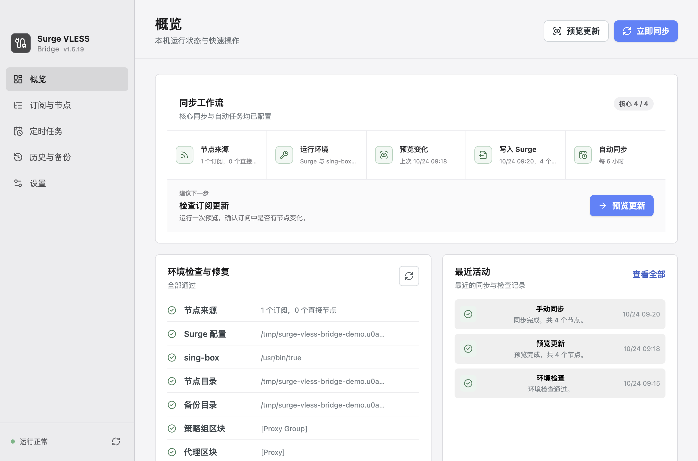

# surge-vless-bridge

[](https://www.npmjs.com/package/surge-vless-bridge)
[](https://www.npmjs.com/package/surge-vless-bridge)

[English README](./README.md) · [更新日志](./CHANGELOG.zh-CN.md)



**让 Surge Mac 支持 VLESS，底层由 sing-box 承接。** 基于 Node.js 的 CLI，把 VLESS 订阅（含 REALITY、XTLS Vision 节点）转换为 Surge Mac 可用的 `external` 外部代理节点。

Surge Mac 不原生支持 VLESS 协议。该工具自动拉取订阅、为每个节点生成 `sing-box` 配置、并保持 Surge 配置同步更新，让你继续使用 Surge 的规则、策略组和面板来使用 VLESS 节点。

## 前置条件

- 已安装 [sing-box](https://github.com/SagerNet/sing-box)（`brew install sing-box`）
- Surge Mac 配置文件中包含 `[Proxy]` 和 `[Proxy Group]` 区块

## macOS 桌面应用

仓库包含 Electron 桌面界面，可以管理订阅、预览更新、执行同步、检查并修复环境、安装 `sing-box`、配置 DNS、恢复备份和管理 macOS 定时任务。

```bash
npm install
npm run desktop
```

生成本地 `.app`：

```bash
npm run desktop:icon
npm run desktop:package
```

详细操作和恢复方法见 [macOS 桌面应用指南](./docs/desktop-app.zh-CN.md)。

## 让 AI Agent 帮你完成配置

把下面这段话丢给 Claude Code、Cursor、Codex 之类的 agent，检测并安装 `sing-box`
和 CLI、生成配置、同步、验证，整套流程它都能完成：

```text
阅读 https://github.com/kankankankankankan/surge-vless-bridge/blob/master/docs/agent-setup.md
然后帮我配置好 surge-vless-bridge
```

[docs/agent-setup.md](./docs/agent-setup.md) 里写清了命令顺序、配置文件的位置、`doctor` 输出怎么读，
以及哪些命令必须先经过你确认。Agent 会向你索要订阅地址并确认 Surge 配置文件路径，其余项都有默认值；在真正
写入之前，它会先用 `sync --dry-run` 给你看一遍改动。

想自己动手？往下看手动配置。

## 手动配置

### 安装

```bash
npm i -g surge-vless-bridge
```

### 快速开始

**1. 生成配置文件：**

```bash
surge-vless-bridge init
```

`init` 会先询问订阅地址，再用 ↑/↓ 选择 Surge 配置文件，然后写入
`~/.config/surge-vless-bridge/config.json` 并打印具体路径。订阅地址直接回车、配置文件按 Esc 即可跳过，
之后手动填写；加 `--no-input` 则跳过全部提问，只写模板。

**2. 编辑配置文件**（仅在跳过了提问时需要）：

```bash
# 用 init 打印的路径打开文件，例如：
open ~/.config/surge-vless-bridge/config.json
```

至少填写以下两个字段：

```json
{
  "subscriptionUrls": ["https://your-provider.com/subscription"],
  "surgeConfigPath": "/Users/you/Library/Application Support/Surge/Profiles/MyProfile.conf"
}
```

- **`subscriptionUrls`**：填入一个或多个 VLESS 订阅地址，所有订阅里的节点会合并到同一个 Surge 策略组。

- **`surgeConfigPath`**：Surge 配置文件的绝对路径。获取方式：
  1. 点击 macOS **菜单栏**中的 Surge 图标
  2. 选择 **切换配置**，在当前使用的配置文件上点击 **在访达中显示**
  3. 在 Finder 中对该文件按 `⌘ + i`，复制"位置"下的完整路径，拼上文件名填入

  > 也可以通过终端快速查看所有配置文件：
  >
  > ```bash
  > ls ~/Library/Application\ Support/Surge/Profiles/
  > ```

**3. 执行同步：**

```bash
surge-vless-bridge sync
```

`sync` 会依次完成：拉取订阅 → 生成 sing-box 配置 → 备份 Surge 配置 → 更新 Surge 配置。

**4. 验证配置是否正常：**

```bash
surge-vless-bridge doctor
```

## 同步过程如何保护你的配置

- 节点先在临时目录里生成并校验，任一环节失败都不会动到 Surge 配置，也不会破坏上一次同步的节点配置。
- 每次写入 Surge 配置前都会备份到 `backupDir`，`restore` 可以恢复最近一次备份。
- 每次同步产生的节点配置会记录在 `manifest.json` 中，因此 `rebuild` 不会复活已从订阅里删除的节点。
- 所有来源都没有解析出 VLESS 节点时，`sync` 拒绝改写配置，避免某个机场过期导致策略组被清空。
- 生成的配置会经过 `sing-box check`，用的是**你本机安装的** sing-box：能查出不支持的选项和非法密钥，但
  **不能验证节点是否真的连得通**。

## 配置文件

由 `init` 创建，默认路径：`~/.config/surge-vless-bridge/config.json`。

```json
{
  "subscriptionUrls": ["https://example.com/subscription-a", "https://example.com/subscription-b"],
  "vlessNodes": [
    "vless://uuid@example.com:443?type=tcp&security=reality&pbk=public-key&sid=short-id&fp=chrome&sni=example.com&flow=xtls-rprx-vision#Example"
  ],
  "surgeConfigPath": "/Users/you/Library/Application Support/Surge/Profiles/Config.conf",
  "policyGroupName": "VLESS",
  "policyGroupTargets": ["代理", "自动选择"],
  "policyGroupExclusions": ["香港线路"],
  "policyGroupTargetModes": { "代理": "reference", "自动选择": "auto" },
  "portStart": 2081,
  "udpRelay": false,
  "udpTestEnabled": false,
  "udpTestTarget": "apple.com@8.8.8.8",
  "tcpFastOpen": false,
  "connectTimeoutEnabled": false,
  "connectTimeoutSeconds": 10,
  "addressResolver": {
    "strategy": "doh",
    "filterSurgeFakeIp": true,
    "dohEndpoint": "https://1.1.1.1/dns-query",
    "dnsServers": ["1.1.1.1", "8.8.8.8"]
  }
}
```

**必填**

| 字段               | 说明                               |
| ------------------ | ---------------------------------- |
| `subscriptionUrls` | 一个或多个 VLESS 订阅地址          |
| `vlessNodes`       | 一个或多个原始 `vless://` 节点地址 |
| `surgeConfigPath`  | Surge 配置文件的绝对路径           |

`subscriptionUrl` 仍然兼容。当 `subscriptionUrl` 与 `subscriptionUrls` 同时存在时，两者会合并去重，且
`subscriptionUrl` 排在最前 —— 新增第二个机场不会导致原订阅丢失。`subscriptionUrl`、`subscriptionUrls`、
`vlessNodes` 至少需要配置其中一种节点来源。

所有来源的节点会合并进同一个策略组。重名节点自动追加序号（`HK 01 2`）；某个订阅没有解析出 VLESS 节点时
只告警，不会中断整次同步。

**选填**

| 字段              | 默认值                                 | 说明                                 |
| ----------------- | -------------------------------------- | ------------------------------------ |
| `policyGroupName`    | `"VLESS"`                              | 要写入的 Surge 策略组名称             |
| `policyGroupTargets` | `[]`                                   | 需要加入 VLESS 组的已有策略组列表     |
| `policyGroupExclusions` | `[]`                                | 需要移除 VLESS 组的已有策略组列表     |
| `policyGroupTargetModes` | `{}`                                | 每个目标组的接入方式                   |
| `portStart`          | `2081`                                 | 起始本地端口，每个节点依次递增        |
| `singBoxBinary`      | 自动检测（`which sing-box`）           | `sing-box` 可执行文件路径             |
| `outputDir`          | `~/.config/surge-vless-bridge/nodes`   | 每个节点的 sing-box 配置保存目录      |
| `backupDir`          | `~/.config/surge-vless-bridge/backups` | Surge 配置备份目录                    |
| `backupKeep`         | `20`                                   | 保留的备份数量，超出的旧备份自动清理  |
| `autoReload`         | `true`                                 | 配置变更后自动让 Surge 重载           |
| `udpRelay`           | `false`                                | 为 external 节点写入 `udp-relay=true` |
| `udpTestEnabled`     | `false`                                | 为启用 UDP 的节点写入 `test-udp`      |
| `udpTestTarget`      | `"apple.com@8.8.8.8"`                | Surge UDP 测试使用的域名和 IPv4       |
| `tcpFastOpen`        | `false`                                | 为 sing-box 远程连接开启 TCP Fast Open |
| `connectTimeoutEnabled` | `false`                             | 使用自定义远程连接超时                 |
| `connectTimeoutSeconds` | `10`                               | 远程连接超时秒数                       |
| `addressResolver`    | 见下方                                 | 为 `addresses=` 解析节点服务器域名    |

游戏、QUIC、语音通话或 UDP DNS 需要经过 VLESS 时，可以开启 `udpRelay`。生成的 sing-box SOCKS 入站支持
UDP ASSOCIATE。上游节点不支持 UDP，或只需要 TCP 流量时保持关闭。

开启 `udpTestEnabled` 后，Surge external 节点会增加 `test-udp=域名@IPv4`。该项依赖 `udpRelay`，默认测试目标为 `apple.com@8.8.8.8`。

`tcpFastOpen` 和连接超时属于 sing-box 远程拨号参数。开启后会分别写入 `tcp_fast_open=true` 和 `connect_timeout=秒数s`，不会写入 Surge 参数。

`addressResolver.strategy` 可选：

| 策略     | 说明                                                                    |
| -------- | ----------------------------------------------------------------------- |
| `doh`    | 使用 `addressResolver.dohEndpoint` 解析，这是默认值。                   |
| `dns`    | 使用 `addressResolver.dnsServers` 解析，例如 `["1.1.1.1", "8.8.8.8"]`。 |
| `system` | 使用 Node.js 系统 DNS 解析。                                            |
| `off`    | 不在生成的 Surge external proxy 条目中写入 `addresses=`。               |

除 `off` 外，任何策略解析不到可用地址时都会自动回退到其余解析方式，因此 DoH 端点不可用或系统解析被
fake-ip 污染时，仍然可以拿到真实 IP。

Surge 的 `addresses=` 只接受单个地址。当一个域名解析出多个结果时优先写入 IPv4，只有在没有 A 记录时
才会写 IPv6。

`addressResolver.filterSurgeFakeIp` 默认为 `true`。它会在写入 `addresses=` 前过滤 `198.18.0.0/15` 地址，避免把 Surge fake-ip 结果固定到 external proxy 条目里。

这里解析的是 VLESS 节点的服务器域名。解析只在同步生成 Surge external 节点时执行，不处理节点显示名称，也不影响经代理访问的网站域名。

### 为什么默认使用 `doh`

开启 Surge 增强模式后，系统 DNS 会返回 `198.18.0.0/15` 段的 fake IP。此时用系统解析代理服务器域名，会把
fake IP 固定写进 `addresses=`，导致节点连不通。`doh` 完全绕开系统解析，因此**不需要关闭增强模式**也能正常
`sync`。只有当你的网络屏蔽了 DoH 端点时，才需要改成 `"strategy": "system"`。

也可以通过命令行参数临时覆盖：

```bash
surge-vless-bridge sync --subscription-url https://example.com/sub --group-name VLESS
```

## 命令说明

| 命令                         | 说明                                            |
| ---------------------------- | ----------------------------------------------- |
| `surge-vless-bridge init`    | 生成配置文件，交互询问订阅地址与 Surge 配置路径 |
| `surge-vless-bridge sync`    | 拉取订阅 → 生成 sing-box 配置 → 更新 Surge      |
| `surge-vless-bridge rebuild` | 仅基于已有本地配置重建 Surge 区块（不访问网络） |
| `surge-vless-bridge restore` | 恢复最近一次 Surge 配置备份                     |
| `surge-vless-bridge clean`   | 移除生成的节点配置与 Surge 中的托管区块         |
| `surge-vless-bridge doctor`  | 检查配置、路径、端口及 Surge 必需区块是否正常   |

### 预览同步结果

`sync --dry-run` 会输出本次同步将生成的节点、端口和配置改动，但不写入任何文件：

```bash
surge-vless-bridge sync --dry-run
```

### 自动重载

Surge 不会监听配置文件变化，同步后需要重载才会生效。如果开启了 HTTP API，本工具会自动触发重载。在 Surge
配置的 `[General]` 中加入：

```ini
http-api = your-key@127.0.0.1:6171
```

未开启时会尝试使用 `surge-cli reload` 兜底。加 `--no-reload` 或设置 `"autoReload": false` 可以关闭该行为，
`doctor` 会显示当前使用的是哪种方式。

自动重载前，应用只会停止命令行中同时匹配当前 `singBoxBinary` 和
`outputDir/sing-box[端口].json` 的 sing-box 进程，释放旧节点占用的本地端口，不影响其他 sing-box 实例。

### 彻底移除

`policyGroupTargets` 可填写多个已有 Surge 策略组。`policyGroupTargetModes` 可为每个组指定 `auto`、
`merge` 或 `reference`。`auto` 遇到 `smart`、`include-other-group` 或 `policy-regex-filter` 时采用
`merge`，其余组采用 `reference`。`merge` 会把 VLESS 合并进 `include-other-group`，`reference`
会把 VLESS 作为直接成员加入。Surge 不允许 `smart` 直接引用其他策略组，因此该组合会被拒绝。

`policyGroupExclusions` 会在同步时从指定组移除 `policyGroupName`。加入和移除都会保留策略组的其他成员和参数。
更新预览会显示每个策略组修改前后的完整配置行。
目标组缺失时会在写入前停止，并列出缺失名称。

`clean` 会删除生成的节点配置、托管区块和对应策略组，同时从已配置的目标组中移除该组。执行前会先备份。

```bash
surge-vless-bridge clean
```

---

## 本地开发

面向参与贡献的开发者。

```bash
git clone https://github.com/kankankankankan/surge-vless-bridge.git
cd surge-vless-bridge
npm install
```

配置文件默认写入当前目录的 `.surge-vless-bridge.json`，而非全局路径。

通过 `tsx` 直接运行源码，无需编译：

```bash
npm run sync         # tsx src/cli.ts sync
npm run doctor       # tsx src/cli.ts doctor
```

编译输出到 `dist/`：

```bash
npm run build
```

## 感谢

本项目基于 [chen86860](https://github.com/chen86860) 创建的原版
[surge-vless-bridge](https://github.com/chen86860/surge-vless-bridge) 继续扩展。
`package.json` 中的原作者信息和 `LICENSE` 中的原版权声明均予以保留。
